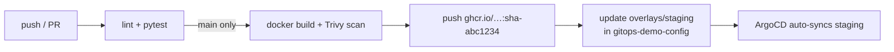

# gitops-demo-app

Small Flask service used to demonstrate a full GitOps pipeline.
**Deployment manifests and the full end-to-end documentation live in the config repo:
[`gitops-demo-config`](https://github.com//gitops-demo-config#1-end-to-end-workflow).**

## Endpoints
| Path | Purpose |
|---|---|
| `/` | Greeting + version, environment, pod name |
| `/healthz` | Liveness probe |
| `/readyz` | Readiness probe |
| `/version` | Image tag baked in at build time |

## CI pipeline (`.github/workflows/ci.yaml`)



| Job | Runs on | Does |
|---|---|---|
| `test` | every push and PR | flake8 + pytest |
| `build-and-push` | push to `main` | builds image tagged `sha-<7-char commit>`, scans with Trivy, pushes to GHCR using `GITHUB_TOKEN` |
| `update-config-repo` | after build | checks out the config repo using a write deploy key, `kustomize edit set image`, commits and pushes (retries on conflict) |

### Required repo settings
| Type | Name | Value |
|---|---|---|
| Secret | `CONFIG_REPO_DEPLOY_KEY` | private half of a deploy key with write access on the config repo |
| Variable | `CONFIG_REPO` | `<user>/gitops-demo-config` |

## Run locally
```bash
pip install -r requirements-dev.txt
pytest -v
python -m app.main            # http://localhost:8080
docker build -t demo-app . && docker run -p 8080:8080 demo-app
```
